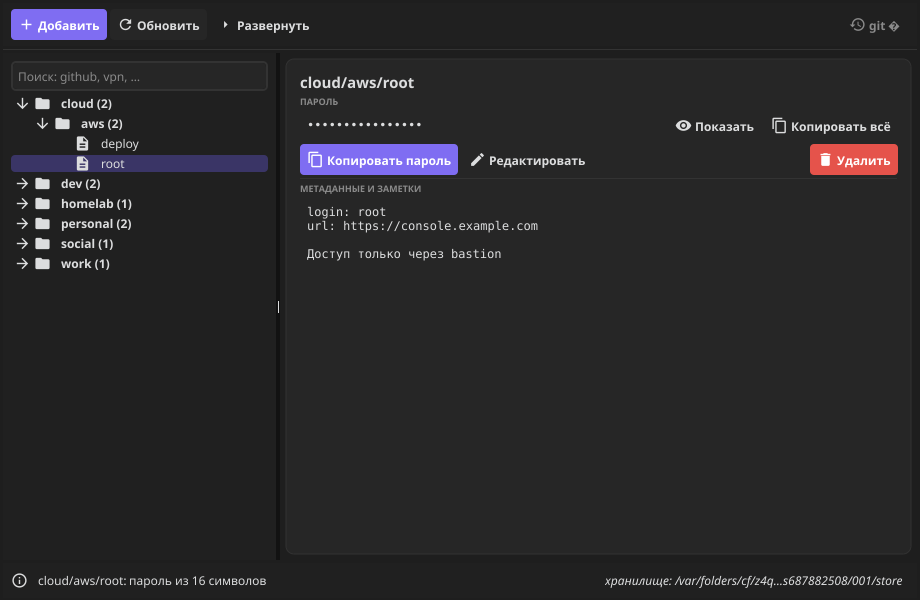
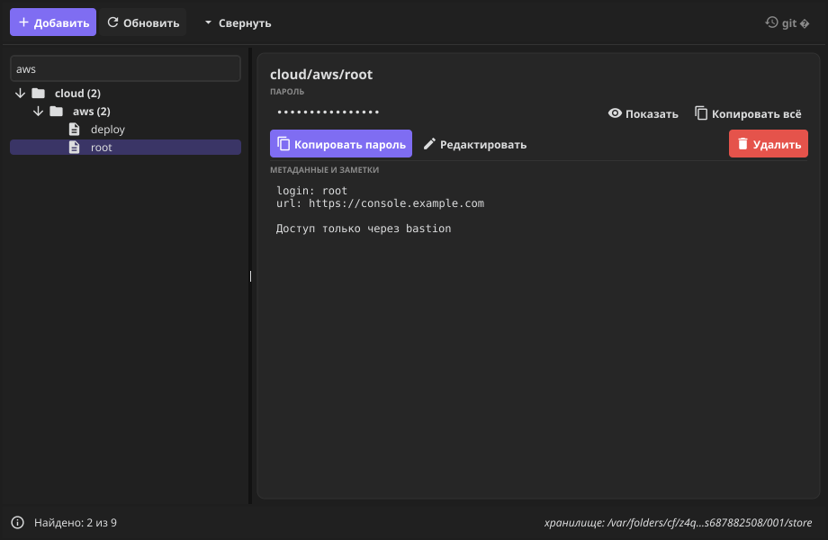
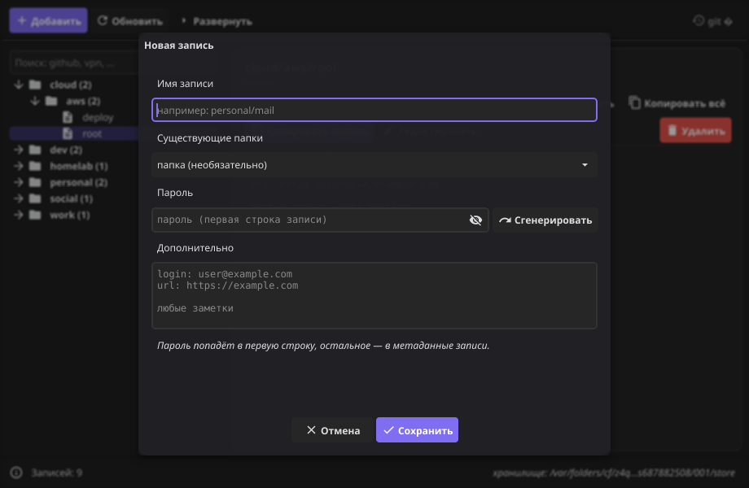

# Go Pass — графический менеджер паролей для `pass`

Небольшое нативное приложение на Go (UI на [Fyne](https://fyne.io)) для работы с
хранилищем [password-store](https://www.passwordstore.org/):

* **просмотр** — дерево папок хранилища: папки раскрываются кликом, записи
  открываются по выбору; поиск фильтрует дерево и сам раскрывает найденные
  ветки; выбранная запись расшифровывается через `pass show`, пароль можно
  показать, рядом — метаданные и заметки;
* **добавление** — новая запись с паролем, генератором и произвольными
  полями (`login:`, `url:`, заметки), папки хранилища подсказываются;
* **копирование** — пароль или вся запись целиком в буфер обмена с
  автоматической очисткой через 45 секунд (`pass -c`-подобное поведение).

Интерфейс компактный: мелкий шрифт (12 pt при `-ui-scale 0.85`), строки дерева
высотой в одну строку текста без «пустых» паддингов, небольшое окно по
умолчанию. Плотность регулируется флагом `-ui-scale` (например `1` вернёт
стандартные размеры Fyne, `0.75` сделает ещё плотнее), а размер окна
запоминается между запусками.



Все операции с шифротекстом идут через штатный CLI `pass`, поэтому
работают ваши `.gpg-id`-получатели, gpg-agent, pinentry, хуки и git-история
хранилища. Список записей читается напрямую из каталога (расшифровка не нужна),
поэтому список открывается мгновенно и не трогает gpg.

## Возможности

| Что | Как |
| --- | --- |
| Дерево записей | иерархия как в самом хранилище: папки — ветки, записи — листья; по умолчанию всё свёрнуто до верхнего уровня |
| Счётчики | у каждой папки показано, сколько записей внутри: `personal (12)` |
| Развернуть / свернуть всё | кнопки на панели инструментов |
| Раскрытые папки | запоминаются между запусками (Fyne preferences) и не теряются при поиске |
| Плотность | компактная тема: шрифт 12 pt, паддинги 3 px, строки дерева без пустых отступов; `-ui-scale` для настройки |
| Размер окна | запоминается между запусками |
| Поиск | подстрока в имени (`⌘F`), найденные ветки раскрываются автоматически, после сброса дерево снова компактное |
| Просмотр | расшифровка выбранной записи, маскированный пароль и кнопка «Показать» |
| Метаданные | строки `login:`, `url:` и заметки — в отдельной прокручиваемой области |
| Добавление | `⌘N`, имя + пароль + генератор + произвольные поля, подсказка существующих папок |
| Перезапись | подтверждение, если запись с таким именем уже есть |
| Копирование | «Копировать пароль» (первая строка) или «Копировать всё» (`⌘C`) |
| Автоочистка | буфер обмена очищается через `-clear-after` (по умолчанию 45 с) |





## Требования

* macOS или Linux с графической сессией;
* установленный `pass` (password-store) и рабочий `gpg`-ключ;
* для сборки — Go 1.24+ и компилятор C (на macOS — Xcode Command Line Tools,
  на Linux — `libgl1-mesa-dev xorg-dev`).

## Сборка и запуск

```bash
make run        # запуск из исходников
make build      # бинарник в bin/go-pass
make test       # тесты
make bundle     # macOS: dist/GoPass.app (двойной клик)
```

Без Makefile:

```bash
go build -o bin/go-pass .
./bin/go-pass
```

## Флаги

| Флаг | Описание |
| --- | --- |
| `-store PATH` | путь к хранилищу (иначе `$PASSWORD_STORE_DIR`, иначе `~/.password-store`) |
| `-clear-after 45s` | через сколько очищать буфер обмена, `0` — не очищать |
| `-app-id ID` | идентификатор приложения для Fyne |
| `-ui-scale 0.85` | плотность интерфейса: `1` — как в Fyne, меньше — компактнее (шрифт, отступы, иконки) |
| `-list` | напечатать имена записей и выйти |
| `-show NAME` | напечатать содержимое записи и выйти |
| `-copy NAME` | скопировать пароль записи в буфер обмена и выйти |
| `-version` | версия |

Примеры без GUI (удобно для скриптов и проверки):

```bash
bin/go-pass -list | head -5
bin/go-pass -show dev/github
bin/go-pass -copy dev/github      # очистит буфер через -clear-after
```

## Горячие клавиши

* клик по папке — раскрыть/свернуть ветку, по записи — расшифровать;
* стрелки — навигация по дереву, `Space` — выбрать, `→`/`←` — раскрыть/свернуть;
* `⌘F` / `Ctrl+F` — фокус в поиск;
* `⌘N` / `Ctrl+N` — новая запись;
* `⌘C` / `Ctrl+C` — копировать пароль выбранной записи (когда фокус не в поле ввода);
* `Enter` в поиске — открыть первую найденную запись (ветки раскроются сами).

## Как это устроено

```
main.go                     флаги, CLI-режимы (-list/-show/-copy), запуск UI
internal/pass/store.go      обёртка над CLI pass: List (обход каталога), Show, Insert
internal/clipboard/         буфер обмена: pbcopy, wl-copy, xclip/xsel, clip.exe
internal/ui/                окно Fyne: список, поиск, детали, диалог добавления
```

* `pass.List()` обходит каталог хранилища и отдаёт имена `*.gpg` без расширения
  (скрытые файлы и `.git` пропускаются — как в `pass ls`).
* Компактная тема (`internal/ui/theme.go`) масштабирует размеры Fyne (текст,
  паддинги, иконки, межстрочный интервал), а подпись строки дерева —
  собственный виджет `elidedText` (`internal/ui/rowlabel.go`) без паддингов
  `widget.Label`: поэтому строка занимает ровно одну строку текста, а длинные
  имена обрезаются многоточием.
* `buildTreeNodes()` превращает плоский список имён в дерево папок: папки идут
  перед записями, пустой uid — невидимый корень, его дети — верхний уровень
  (`cloud`, `dev`, `personal`, …). Там же считается число записей в поддереве
  для подписи папок. Поиск строит такое же дерево, но только из совпавших
  записей, и раскрывает все ветки.
* Раскрытые папки хранятся в preferences под ключом `tree.openBranches`;
  изменения, вызванные поиском или разворотом всех веток, не записываются, а
  состояние до поиска запоминается в памяти и восстанавливается после сброса.
* `pass.Show()` вызывает `pass show <имя>` и разбирает ответ: первая строка —
  пароль, затем строки `Ключ: значение`, затем заметки.
* `pass.Insert()` вызывает `pass insert --multiline --force <имя>`, передавая
  содержимое в stdin. Если `pass` упал только на `git commit` (например, не
  настроен `user.email`), запись считается сохранённой — файл уже создан.
* Команды запускаются без терминала, поэтому `pass` не может «зависнуть» на
  интерактивном вопросе; запрос парольной фразы показывает pinentry.
* Расшифрованные значения кешируются в памяти на время сессии. Кнопка
  «Обновить» и добавление записи сбрасывают кеш.

## Безопасность

* Пароли не пишутся на диск приложением: только память процесса и буфер обмена.
* Буфер обмена очищается через `-clear-after`, но только если там всё ещё лежит
  скопированное нами значение (ваш более поздний `copy` не затирается).
* Приложение не изменяет и не удаляет существующие записи, не работает с
  репозиторием хранилища — только чтение и добавление.

## Тесты

```bash
make test     # go test ./...
go test -race ./...
```

Покрыто: разбор записей и валидация имён (`internal/pass`), вызовы CLI через
скрипт-заглушку `pass`, логика очистки буфера обмена (`internal/clipboard`),
генератор паролей и сценарии окна — список, поиск, расшифровка, показ,
копирование, сохранение (`internal/ui`, на тестовом драйвере Fyne, без дисплея).

Снимки интерфейса можно перегенерировать без графической сессии:

```bash
GOPASS_SNAPSHOT_DIR=/tmp/shots go test ./internal/ui -run TestVisualStates
```

## Ограничения

* Редактирование и удаление записей пока не реализованы.
* Двухфакторные `otp`-записи `pass` отображаются как обычный текст (без генерации кода).
* На Linux без `wl-copy`/`xclip`/`xsel` копирование недоступно, остальное работает.
